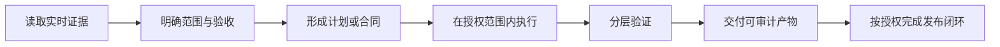

# whojay Skill

> 使用 [dot-skill](https://github.com/titanwings/colleague-skill) 从真实 Codex 工作记录中蒸馏出的工程与学术双工作流 Skill。
>
> An evidence-driven Codex skill for engineering and academic work.

[](LICENSE)
[](SKILL.md)
[](meta.json)

`whojay` 不是一份泛化的“人设提示词”，而是一套可以直接交给 Codex 使用的工作方法：先从实时证据建立事实边界，再明确范围和验收条件，在授权范围内执行，并用可复查的验证与产物完成闭环。

它同时覆盖：

- **工程工作**：仓库诊断、架构与接口设计、实现、调试、测试、代码审查、Git/PR 交付和长任务治理。
- **学术工作**：研究问题定义、最近工作与差距分析、baseline 对齐、实验计划、证据审计、论文图表、审稿和 rebuttal。
- **工程—学术衔接**：把研究假设落实为可复现的软件和实验，再把工程产物转化为有证据边界的学术主张。
- **静默请求合同**：内部整理结果、权限、约束和验收条件；只有实质性歧义或用户要求时才展示重构内容。
- **Skill 路由**：选择最小、非重叠的专业 Skill，并由 whojay 保留授权、集成和最终验证。

## 快速开始

从公开仓库安装默认入口（文档命令；文件复制路径已在临时目录 smoke 测试）：

```bash
git clone --depth 1 https://github.com/WhoJay0609/whojay-skill.git
mkdir -p ~/.codex/skills/colleague-whojay
cp whojay-skill/{SKILL.md,work.md,persona.md,work_skill.md,persona_skill.md,README.md,manifest.json,meta.json} \
  ~/.codex/skills/colleague-whojay/
```

新建 Codex 任务（或重启以刷新技能列表），然后调用（首次调用示例；本仓库未运行 Codex 宿主）：

```text
$colleague-whojay 只做只读诊断：检查这个仓库为什么加载失败，给出根因证据。
```

默认入口会先按当前请求整理范围、授权、证据和验收条件，再按需加载 Work 或 Persona 正文；不会因为安装命令本身创建 Goal 或执行外部操作。

## 为什么做这个 Skill

通用 Agent 往往知道“怎么做”，但不一定知道：

- 哪个文件、日志或运行信号才是当前事实源；
- 什么情况下应该继续自主执行，什么情况下必须暂停确认；
- 如何区分计划、实现、运行、产物完成与结论成立；
- 如何避免用绿色测试、漂亮图表或模拟审稿结果伪造成功；
- 用户要求完整交付时，什么时候才真正完成 Git、实验或论文闭环。

`whojay` 把这些重复出现的判断方式固化为 Work + Persona 两层规则，使 Agent 不只复现操作步骤，也复现决策边界。

## 由 dot-skill 蒸馏生成

本仓库使用开源项目 [titanwings/colleague-skill](https://github.com/titanwings/colleague-skill) 提供的 **dot-skill** 完成分析、蒸馏和打包。dot-skill 采用 **Work Skill + Persona** 双层架构：

- **Work** 提取一个人反复使用的技术方法、执行流程、验收门槛和经验规则；
- **Persona** 提取其决策优先级、表达方式、纠偏反应、授权边界和压力下的行为模式。

`whojay` 使用 `colleague` 类型的 `dot.colleague.v1` 预设，实际生成链路为：

1. 汇总本机 Codex 会话和线程元数据；
2. 按会话去重，并过滤工具输出、凭据、私人标识符和长段原文；
3. 由 Work Analyzer 提取工程与学术工作流、失败恢复模式和验收规则；
4. 由 Persona Analyzer 提取可观察的协作、决策和纠偏模式；
5. 经人工确认后，由 builder 分别生成 [`work.md`](work.md) 与 [`persona.md`](persona.md)；
6. 由 router 入口 [`SKILL.md`](SKILL.md) 集中承载 Core contract、请求合同和 Skill 路由，同时保留 [`meta.json`](meta.json) 与 [`manifest.json`](manifest.json) 的生成元数据。

因此，这个仓库保留一个轻量的 Codex 默认入口、职责分离的 Work/Persona 正文和两个薄能力入口。高影响规则只在一个权威位置定义，避免生成副本之间的正文漂移。

## v2.5：静默请求合同与 Skill 路由

v2.5 将请求整理从默认可见的元提示步骤改为内部合同。每个新请求都会在内部提取结果、权限、约束、证据和验收条件，但不会默认展示重构文本、具体模型名或 reasoning effort。

只有在以下情况才向用户展示整理结果或提出最小问题：

1. 用户明确要求查看重构后的提示词或配置建议；
2. 存在会改变范围、结果、成本、副作用或验收标准的实质性歧义。

复杂或长期任务本身不会创建持久化 Goal；只有用户明确要求创建或设置 Goal 时才允许使用 Goal 能力。

`whojay` 现在还提供 Skill 路由合同：优先使用用户点名的 Skill，其次选择最窄的专业 Skill，再由 `whojay` 负责跨 Skill 统筹、权限边界、结果整合和最终验证。重叠 Skill 不因关键词匹配而重复加载；不可用的 provider、model、tool 或 Skill 不会被静默替代。

当用户显式调用 `whojay` 处理非简单工程或学术工作流时，入口还会遵循当前 `AGENTS.md` 中的角色路由和最终验收门禁。每次子任务必须使用完整、边界明确的 `WORK_PACKET_V1`；DeepSeek 等跨 provider 路由需要独立的无凭据 packet、唯一任务名和精确清理，且外部 reviewer 不能替代要求的原生最终审查。

Work 与 Persona 保持职责分离：`work.md` 负责工程、学术、验证、运行时和多代理流程；`persona.md` 负责表达、判断、纠偏和 continuation 风格。`work_skill.md` 与 `persona_skill.md` 是先读取 Core contract 再加载相应正文的薄入口，不再复制完整正文。

恢复、授权、事实等级、实验账本和完成定义仍以 `SKILL.md` 与对应 Work 章节为准；工具回执、子代理总结和模拟审查不能替代正式证据。

## 核心工作模型



四条最高优先级原则：

| 原则 | 含义 |
| --- | --- |
| 证据优先 | 实时仓库、配置、日志、数据库、主机信号和正式产物高于记忆、摘要与推测 |
| 边界清楚 | 区分事实/推断/未知、分析/执行、实现/运行、产物/结论、本地/远端 |
| 不伪造成功 | 不通过放宽硬约束、替换指标、隐藏失败或 synthetic 结果来换取“完成” |
| 闭环才算完成 | 验证、交付、同步和清理没有达到用户要求，就明确报告部分完成或阻塞 |

### 事实等级

Skill 要求所有重要结论落入以下一种状态：

1. **已验证**：由当前权威证据直接支持。
2. **合理推断**：有多条证据支持，但尚未直接确认。
3. **未知或阻塞**：证据、权限、运行状态或验收条件不足。

## 工程工作流

工程任务遵循一条可回放的执行链：

1. **现场诊断**：读取适用规则、实时仓库状态、配置、日志与产物，定位真正的 authority chain。
2. **明确合同**：写清目标、范围、硬约束、外部副作用和验收条件。
3. **隔离实现**：保护脏工作区，按改动风险、并行度和隔离收益选择当前工作区或独立 worktree。
4. **根因调试**：稳定复现，沿真实调用链定位首个错误状态，做最小修复。
5. **分层验证**：聚焦测试 → 回归测试 → lint/build → 真实入口 smoke → 产物与指标审计。
6. **独立审查**：高风险改动增加正确性、安全、性能和简化检查。
7. **交付闭环**：按授权完成 commit、push、PR、门禁、merge、本地同步和临时分支清理。

它尤其强调：诊断请求默认保持只读；原型和 mock 只能承担诊断角色；不能为了绿色结果放宽物理、数据、连接、权限或验收语义。

## 学术工作流

学术任务从问题和证据开始，而不是从论文措辞开始：

1. **问题定位**：把模糊方向压缩成研究问题，检查 closest work、collision 和真实 gap。
2. **方法合同**：明确输入、输出、假设、符号、优化目标、约束与失败条件。
3. **Baseline 账本**：记录模型、数据集、压缩率、校准设置、后端、硬件、seed 和指标来源。
4. **假设驱动实验**：预先写清比较对象、控制变量、admission predicate、决策规则和停止条件。
5. **状态治理**：明确区分 `planned`、`UNVERIFIED`、`running`、`artifact-complete`、`blocked` 和 `closed`。
6. **结果到主张**：先更新证据账本，再写表格、caption、摘要与结论；证据不足时主动降低主张强度。
7. **论文与引用**：保证术语、符号、图表、数字、引用来源和 venue 规范一致。
8. **对抗审查**：用 reviewer/red-team 暴露新颖性碰撞、实验缺口和逻辑跳跃，修复后再审查。

这里的核心边界是：实现完成不等于实验获批，实验启动不等于结果完成，产物生成不等于科学主张成立，模拟 reviewer 也不代表真实同行评审。

## 安装

### 让 Codex 安装

在 Codex 中发送：

```text
请安装 https://github.com/WhoJay0609/whojay-skill
```

### 手动安装

命令和首次调用见上面的[快速开始](#快速开始)。安装后在新的 Codex 任务中调用；如果技能列表尚未刷新，请新建任务或重新启动 Codex。

## 使用示例

### 工程诊断

```text
$colleague-whojay 只做只读诊断：检查这个仓库为什么加载失败，给出真实 authority chain 和根因证据。
```

### 实现与交付

```text
$colleague-whojay 在独立 worktree 中实现这个需求，完成分层验证；先不要提交或推送。
```

### 研究方案

```text
$colleague-whojay 评估这个研究 idea：先做 closest-work collision，再给出方法合同、baseline ledger 和最小实验矩阵。
```

### 论文证据审计

```text
$colleague-whojay 检查论文中每个数字和主张是否有正式实验产物支持，并区分 verified、inferred 和 unverified。
```

### 输入与可核对输出（说明性示例）

下面展示输出结构；方括号中的内容必须由当前仓库、日志或产物填充，不是预先测得的结果：

```text
输入：$colleague-whojay 只做只读诊断：检查服务为什么加载失败，不要修改文件或重启服务。

输出：
结果：[根据实时证据得到的首个错误状态或根因]
已验证：[实际读取的路径、日志、命令及结果]
未验证：[仍缺少的运行时或外部证据]
范围：[只读；没有文件、服务或远端写入]
```

如果任务授权实现，输出还应列出实际修改、分层验证和剩余风险；模拟结果或工具回执不能替代正式证据。

## 仓库结构

| 文件 | 作用 |
| --- | --- |
| [`SKILL.md`](SKILL.md) | Core contract、静默请求合同、Progressive loading 和 Skill routing 入口 |
| [`work.md`](work.md) | 工程与学术工作流正文 |
| [`work_skill.md`](work_skill.md) | 先加载 Core contract 再读取 `work.md` 的独立 Work 薄入口 |
| [`persona.md`](persona.md) | 决策、表达、纠偏和协作边界 |
| [`persona_skill.md`](persona_skill.md) | 先加载 Core contract 再读取 `persona.md` 的独立 Persona 薄入口 |
| [`meta.json`](meta.json) | v2 身份、能力、证据边界和生成元数据 |
| [`manifest.json`](manifest.json) | dot-skill v3 清单、entrypoint 与运行时声明 |

当前公开包以 `SKILL.md` 的 Codex 直接安装路径为主要验证对象。Codex 也支持通过两个薄入口独立加载 Work 或 Persona；其他运行时是否解析这些相对引用需要在对应环境单独验证。更新时应先修改 canonical 正文，再同步入口和元数据，避免 Work、Persona 与运行时内容漂移。

## 兼容性

| 入口 | 状态 | 依据 |
| --- | --- | --- |
| Codex 本地 Skill | documented；仓库契约测试与临时目录复制 smoke 已通过（2026-09-12） | [`SKILL.md`](SKILL.md)、[`tests/test_skill_contract.py`](tests/test_skill_contract.py) |
| `manifest.json` 中列出的其他运行时 | declared；本仓库未做运行时测试 | [`manifest.json`](manifest.json) 的 `compatible_runtimes` |

## 历史蒸馏依据

本版本的证据截止时间为 **2026-07-22**：

- 扫描 3,687 个本机 Codex rollout 文件；
- 去重、补充线程元数据并进行隐私过滤后，纳入 3,663 张证据卡片；
- 其中 996 个直接主会话用于主要行为归纳；
- 2,667 个子代理或守护会话只用于交叉印证。

这是一份**工作行为与协作方式蒸馏**，不是人物身份画像。仓库不包含原始会话、命令输出、凭据、会话 ID、私人标识符或本机绝对路径。

v2.5 是基于现有 Work/Persona 证据的人工结构校正与路由增强，不代表重新扫描或新增会话证据；`meta.json` 中的 evidence source 保持原生成批次口径。

## 边界与限制

- 公司、职位级别、组织部门、性别、MBTI、学历层级和线下人际属性没有可靠证据，因此保持未设置。
- Skill 提供决策与执行框架，不替代对当前仓库、运行环境、论文证据和外部状态的实时核验。
- 自动重构输入不扩大用户授权；持久化 Codex Goal 只接受当前请求中的明确创建指令。
- 未经明确授权，不应执行删除、远程发布、外部消息、付费调用或 GPU 正式运行。
- 学术工作流帮助管理证据边界，但不能自动证明新颖性、科学有效性、同行评审结果或论文录用。

## 贡献与求助

- 行为契约的修改应先更新 [`SKILL.md`](SKILL.md)；Work、Persona 和薄入口保持职责分离，并运行 `python3 -m unittest discover -s tests -v`。
- 文档或安装问题请附上调用文本、使用的入口、期望行为和实际输出；提交前删除凭据、会话标识符和本机路径。
- 报告问题时请区分已验证事实、合理推断和未知项，便于复查而不把建议误当成能力承诺。

## License

[MIT](LICENSE)
