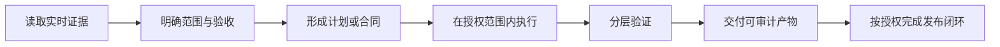

# whojay Skill

> 使用 [dot-skill](https://github.com/titanwings/colleague-skill) 从真实 Codex 工作记录中蒸馏出的工程与学术双工作流 Skill。

[](LICENSE)
[](SKILL.md)
[](meta.json)

`whojay` 不是一份泛化的“人设提示词”，而是一套可以直接交给 Codex 使用的工作方法：先从实时证据建立事实边界，再明确范围和验收条件，在授权范围内执行，并用可复查的验证与产物完成闭环。

它同时覆盖：

- **工程工作**：仓库诊断、架构与接口设计、实现、调试、测试、代码审查、Git/PR 交付和长任务治理。
- **学术工作**：研究问题定义、最近工作与差距分析、baseline 对齐、实验计划、证据审计、论文图表、审稿和 rebuttal。
- **工程—学术衔接**：把研究假设落实为可复现的软件和实验，再把工程产物转化为有证据边界的学术主张。
- **输入自动重构**：执行前把原始请求整理成精简、结果优先的提示词，同时保留事实、授权和验收边界。

## 为什么做这个 Skill

通用 Agent 往往知道“怎么做”，但不一定知道：

- 哪个文件、日志或运行信号才是当前事实源；
- 什么情况下应该继续自主执行，什么情况下必须暂停确认；
- 如何区分计划、实现、运行、产物完成与结论成立；
- 如何避免用绿色测试、漂亮图表或模拟审稿结果伪造成功；
- 用户要求完整交付时，什么时候才真正完成 Git、实验或论文闭环。

`whojay` 把这些重复出现的判断方式固化为 Work + Persona 两层规则，使 Agent 不只复现操作步骤，也复现决策边界。

## 由 dot-skill 蒸馏生成

本仓库使用开源项目 [titanwings/colleague-skill](https://github.com/titanwings/colleague-skill) 提供的 **dot-skill** 完成分析、蒸馏和打包。dot-skill 采用 **Work Skill + Persona** 双层架构：

- **Work** 提取一个人反复使用的技术方法、执行流程、验收门槛和经验规则；
- **Persona** 提取其决策优先级、表达方式、纠偏反应、授权边界和压力下的行为模式。

`whojay` 使用 `colleague` 类型的 `dot.colleague.v1` 预设，实际生成链路为：

1. 汇总本机 Codex 会话和线程元数据；
2. 按会话去重，并过滤工具输出、凭据、私人标识符和长段原文；
3. 由 Work Analyzer 提取工程与学术工作流、失败恢复模式和验收规则；
4. 由 Persona Analyzer 提取可观察的协作、决策和纠偏模式；
5. 经人工确认后，由 builder 分别生成 [`work.md`](work.md) 与 [`persona.md`](persona.md)；
6. 通过 dot-skill writer 合并为可直接加载的 [`SKILL.md`](SKILL.md)，同时生成 [`meta.json`](meta.json) 和 [`manifest.json`](manifest.json)。

因此，这个仓库既保留 Codex 可直接使用的合并 Skill，也保留 dot-skill 的拆分产物和 schema v3 元数据，便于后续校正、重新生成和版本追踪。

## v2：自动重构每次输入

v2 集成了 `refine-user-prompt` 的核心请求重构能力。每次收到新任务时，`whojay` 会先：

1. 提取用户真正需要的结果、已知事实、成功标准、范围、权限、证据要求和输出格式；
2. 删除重复或不影响行为的描述，按任务复杂度保留最少必要结构；
3. 对低风险缺省采用明确标注的窄假设，对实质性歧义只询问一个最小必要问题；
4. 在执行前展示可直接使用的“重构后的提示词”；
5. 给出一个执行模式、可用 GPT-5.6 模型和思考强度建议，再按原始授权继续。

可选执行模式包括：

| 模式 | 行为 |
| --- | --- |
| `refine_only` | 只润色、计划或分析；展示重构提示词后停止 |
| `refine_then_answer` | 展示提示词后完成不需要修改状态的回答、诊断或审查 |
| `refine_then_execute` | 展示提示词后执行已经授权的普通修改与验证 |
| `refine_then_create_goal` | 只有用户明确要求创建或设置持久化 Codex Goal 时才允许使用 |

> [!IMPORTANT]
> 重构提示词中的“目标”只是对预期结果的描述，不等于创建持久化 Codex Goal。`whojay` 不会因为任务复杂、长期、跨文件、像论文或适合跟踪就主动设置 Goal；只有用户在当前请求中明确提醒或要求“创建 Goal / 设置目标”时才会创建。Goal 也不会扩大删除、发布、付费调用或 GPU 运行等操作权限。

自动重构不会偷偷加入事实、权限、工具、交付物、截止时间或质量承诺。模型与思考强度只是建议，不代表运行配置已经被切换。

## 核心工作模型



四条最高优先级原则：

| 原则 | 含义 |
| --- | --- |
| 证据优先 | 实时仓库、配置、日志、数据库、主机信号和正式产物高于记忆、摘要与推测 |
| 边界清楚 | 区分事实/推断/未知、分析/执行、实现/运行、产物/结论、本地/远端 |
| 不伪造成功 | 不通过放宽硬约束、替换指标、隐藏失败或 synthetic 结果来换取“完成” |
| 闭环才算完成 | 验证、交付、同步和清理没有达到用户要求，就明确报告部分完成或阻塞 |

### 事实等级

Skill 要求所有重要结论落入以下一种状态：

1. **已验证**：由当前权威证据直接支持。
2. **合理推断**：有多条证据支持，但尚未直接确认。
3. **未知或阻塞**：证据、权限、运行状态或验收条件不足。

## 工程工作流

工程任务遵循一条可回放的执行链：

1. **现场诊断**：读取适用规则、实时仓库状态、配置、日志与产物，定位真正的 authority chain。
2. **明确合同**：写清目标、范围、硬约束、外部副作用和验收条件。
3. **隔离实现**：保护脏工作区，优先在独立 worktree 或明确隔离面修改一个逻辑接缝。
4. **根因调试**：稳定复现，沿真实调用链定位首个错误状态，做最小修复。
5. **分层验证**：聚焦测试 → 回归测试 → lint/build → 真实入口 smoke → 产物与指标审计。
6. **独立审查**：高风险改动增加正确性、安全、性能和简化检查。
7. **交付闭环**：按授权完成 commit、push、PR、门禁、merge、本地同步和临时分支清理。

它尤其强调：诊断请求默认保持只读；原型和 mock 只能承担诊断角色；不能为了绿色结果放宽物理、数据、连接、权限或验收语义。

## 学术工作流

学术任务从问题和证据开始，而不是从论文措辞开始：

1. **问题定位**：把模糊方向压缩成研究问题，检查 closest work、collision 和真实 gap。
2. **方法合同**：明确输入、输出、假设、符号、优化目标、约束与失败条件。
3. **Baseline 账本**：记录模型、数据集、压缩率、校准设置、后端、硬件、seed 和指标来源。
4. **假设驱动实验**：预先写清比较对象、控制变量、admission predicate、决策规则和停止条件。
5. **状态治理**：明确区分 `planned`、`UNVERIFIED`、`running`、`artifact-complete`、`blocked` 和 `closed`。
6. **结果到主张**：先更新证据账本，再写表格、caption、摘要与结论；证据不足时主动降低主张强度。
7. **论文与引用**：保证术语、符号、图表、数字、引用来源和 venue 规范一致。
8. **对抗审查**：用 reviewer/red-team 暴露新颖性碰撞、实验缺口和逻辑跳跃，修复后再审查。

这里的核心边界是：实现完成不等于实验获批，实验启动不等于结果完成，产物生成不等于科学主张成立，模拟 reviewer 也不代表真实同行评审。

## 安装

### 让 Codex 安装

在 Codex 中发送：

```text
请安装 https://github.com/WhoJay0609/whojay-skill
```

### 手动安装

```bash
git clone --depth 1 https://github.com/WhoJay0609/whojay-skill.git
mkdir -p ~/.codex/skills/colleague-whojay
cp whojay-skill/SKILL.md ~/.codex/skills/colleague-whojay/SKILL.md
```

安装后在新的 Codex 任务中调用：

```text
$colleague-whojay 按照我的工作流处理这个任务
```

如果技能列表尚未刷新，新建任务或重新启动 Codex。

## 使用示例

### 工程诊断

```text
$colleague-whojay 只做只读诊断：检查这个仓库为什么加载失败，给出真实 authority chain 和根因证据。
```

### 实现与交付

```text
$colleague-whojay 在独立 worktree 中实现这个需求，完成分层验证；先不要提交或推送。
```

### 研究方案

```text
$colleague-whojay 评估这个研究 idea：先做 closest-work collision，再给出方法合同、baseline ledger 和最小实验矩阵。
```

### 论文证据审计

```text
$colleague-whojay 检查论文中每个数字和主张是否有正式实验产物支持，并区分 verified、inferred 和 unverified。
```

## 仓库结构

| 文件 | 作用 |
| --- | --- |
| [`SKILL.md`](SKILL.md) | Codex 直接加载的 Work + Persona 合并入口 |
| [`work.md`](work.md) | 工程与学术工作流正文 |
| [`work_skill.md`](work_skill.md) | dot-skill 生成的独立 Work 入口 |
| [`persona.md`](persona.md) | 决策、表达、纠偏和协作边界 |
| [`persona_skill.md`](persona_skill.md) | dot-skill 生成的独立 Persona 入口 |
| [`meta.json`](meta.json) | v2 身份、能力、证据边界和生成元数据 |
| [`manifest.json`](manifest.json) | dot-skill v3 清单、entrypoint 与运行时声明 |

当前公开包以 `SKILL.md` 的 Codex 直接安装路径为主要验证对象。拆分文件保留生成来源和后续修订能力；更新时应重新生成合并入口，避免 Work、Persona 与运行时内容漂移。

## 蒸馏依据

本版本的证据截止时间为 **2026-07-22**：

- 扫描 3,687 个本机 Codex rollout 文件；
- 去重、补充线程元数据并进行隐私过滤后，纳入 3,663 张证据卡片；
- 其中 996 个直接主会话用于主要行为归纳；
- 2,667 个子代理或守护会话只用于交叉印证。

这是一份**工作行为与协作方式蒸馏**，不是人物身份画像。仓库不包含原始会话、命令输出、凭据、会话 ID、私人标识符或本机绝对路径。

## 边界与限制

- 公司、职位级别、组织部门、性别、MBTI、学历层级和线下人际属性没有可靠证据，因此保持未设置。
- Skill 提供决策与执行框架，不替代对当前仓库、运行环境、论文证据和外部状态的实时核验。
- 自动重构输入不扩大用户授权；持久化 Codex Goal 只接受当前请求中的明确创建指令。
- 未经明确授权，不应执行删除、远程发布、外部消息、付费调用或 GPU 正式运行。
- 学术工作流帮助管理证据边界，但不能自动证明新颖性、科学有效性、同行评审结果或论文录用。

## License

[MIT](LICENSE)
